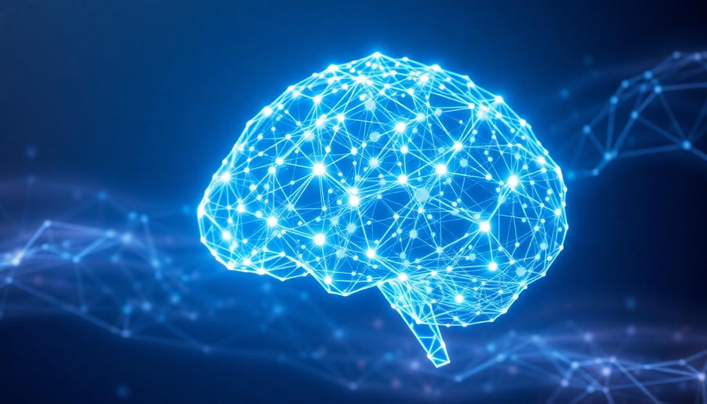

<!-- Replace this path with the uploaded banner's repository path -->

  

<h1 align="center">Hey, I'm Shreyansh Pandey 👋</h1>

<h3 align="center">
  AI / ML Enthusiast | CSE Undergraduate @ IIIT Nagpur
</h3>

  Machine Learning · Deep Learning · Generative AI

---

### About Me

I'm a Computer Science undergraduate at **IIIT Nagpur**, interested in Machine Learning, Deep Learning, and Generative AI.

I enjoy building practical projects, experimenting with different model architectures, and understanding how AI systems work under the hood.

---

### Tech Stack

**Languages**

**Machine Learning & Data Science**

**Deep Learning & Generative AI**

**Tools & Frameworks**

---

### Selected Projects

**Traffic Prediction using Ensemble Machine Learning**

Experimented with geospatial and temporal feature engineering and LightGBM/XGBoost ensemble models.

**Stock Price Prediction**

Built time-series forecasting models using stacked LSTM and GRU architectures on historical OHLCV data.

**Game Recommendation System**

Developed a content-based recommendation system using TF-IDF vectorization and cosine similarity across approximately 26,000 games.

---

### Connect With Me

  
  
  

  <i>Always learning. Always building.</i>

